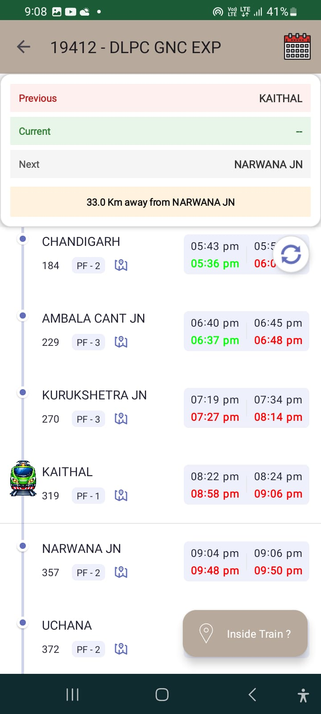
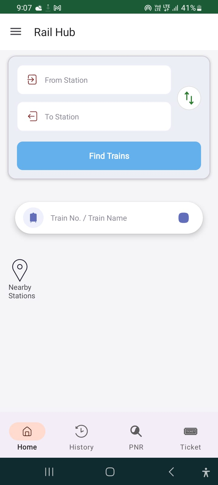
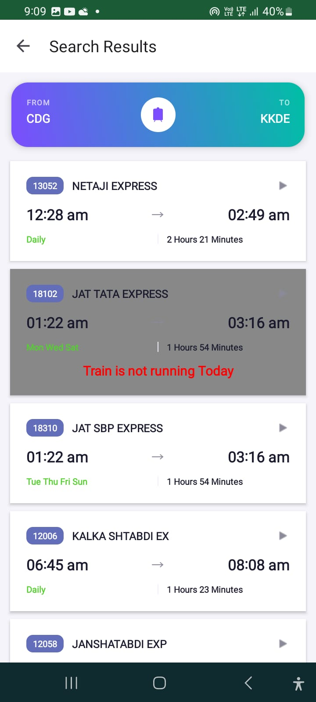
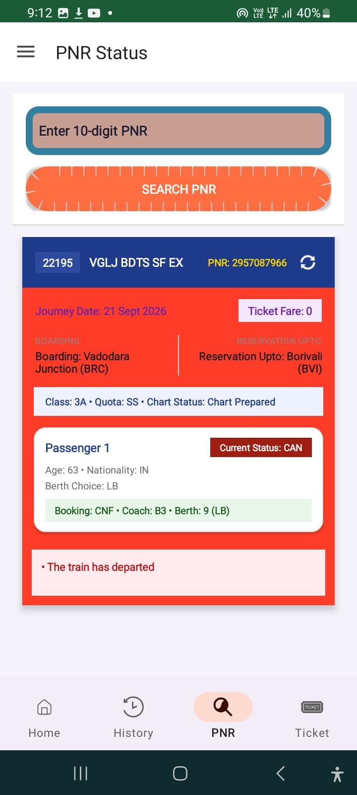
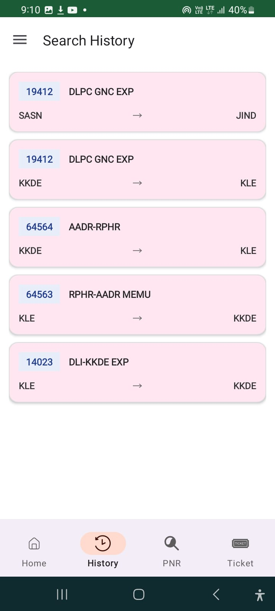
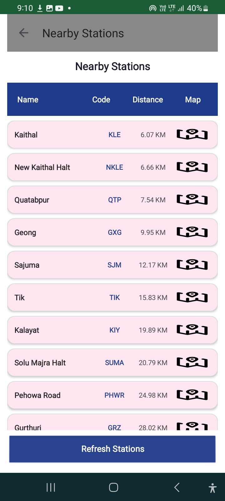
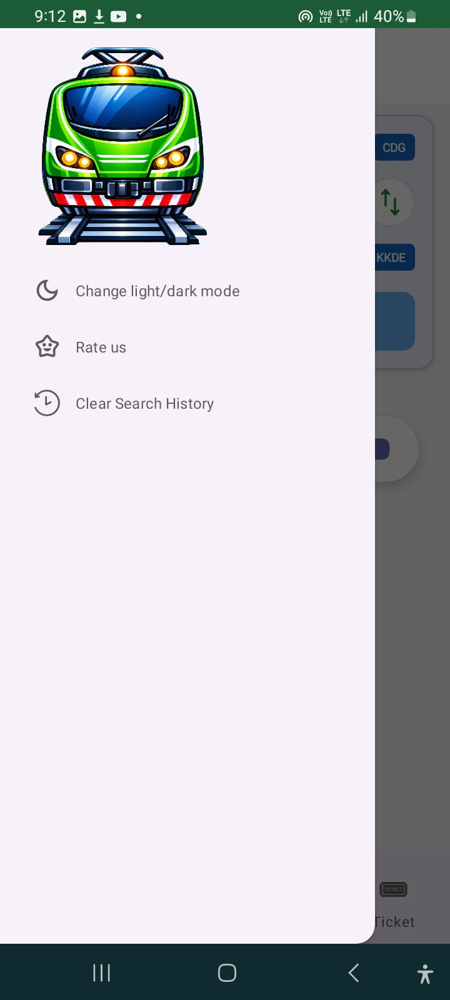

# 🚆 Railhub

Railhub is a lightweight Android app for Indian Railways passengers that puts live train tracking, PNR status lookup, train search between stations, and nearby railway stations — all in one place.

## ✨ Features

### 🔍 Trains Between Stations
Search for all trains running between any two stations:
- Search by station name or station code (e.g. Kaithal → Kurukshetra Junction, KLE → KKDE)
- One-tap swap button to reverse source and destination
- Results show train number, name, departure/arrival times, running frequency (e.g. Daily, Wed Sat) and journey duration
- Trains that are not running on the selected day are clearly greyed out with a "Train is not running Today" warning

### 📍 Live Train Tracking
Track any train in real time by train number or name:
- Timeline view of the full route with every halt
- Current position highlighted, with **Previous**, **Current** and **Next** station summary
- Scheduled vs. actual arrival/departure times, with delays shown in red
- Platform numbers (where available) and distance markers for each station
- "Arrived at" notifications for the train's latest station
- Date picker to view the running status for any day, plus a refresh button
- **"Inside Train?"** mode — travelling on the train yourself? Get precise updates for where you are on the route

### 🎫 PNR Status
Check the status of a reserved ticket instantly:
- Enter your 10-digit PNR number and hit **Search PNR**
- See train number & name, journey date, ticket fare, boarding and reservation stations
- Class, quota and chart status (e.g. Class: 3A • Quota: SS • Chart Prepared)
- Per-passenger details: current status (CNF / CAN / WL), age, berth choice, coach and berth number
- Live updates such as "The train has departed"

### 🗺️ Nearby Stations
Find railway stations close to you using GPS:
- Sorted list of nearby stations with name, station code and distance (e.g. Kaithal — KLE — 6.13 KM)
- Map link for every station to open its exact location
- **Refresh Stations** button to re-scan based on your current location

### 🕘 Search History
- Your recent train searches are saved for quick re-access, showing train number, train name and route
- Clear the entire history anytime from the menu

## 📱 Screens

| Screen | What you'll see |
|---|---|
| **Home** | Station-to-station search, train tracking search bar, and Nearby Stations shortcut |
| **Search Results** | All trains between two stations with timings, frequency and duration |
| **Live Status** | Route timeline with live position, delays and platform info |
| **PNR Status** | Full ticket and passenger status for a 10-digit PNR |
| **Nearby Stations** | GPS-based list of stations with distance and map links |
| **History** | Recently searched trains |
| **Menu** | Light/dark mode toggle, rate the app, clear search history |

## 🧭 Navigation

The app uses a simple bottom navigation bar with four tabs:

**Home** 🏠 · **History** 🕘 · **PNR** 🔎 · **Ticket** 🎟️

## 🛠️ Getting Started

1. Open the app — no sign-up required
2. On the Home screen, either:
   - Enter a source and destination and tap **Find Trains**, or
   - Search a train by number/name to track it live, or
   - Tap **Nearby Stations** to discover stations around you
3. For ticket status, go to the **PNR** tab, enter your 10-digit PNR and tap **Search PNR**

## 📸 Screenshots

| Live Train Status | Home | Search Results |
|---|---|---|
|  |  |  |

| PNR Search & Status | Search History | Nearby Stations | Menu |
|---|---|---|---|
|  |  |  |  |

## 🌗 Customisation

- **Light / Dark mode** — switch themes from the hamburger menu
- **Clear Search History** — wipe saved searches from the hamburger menu
- **Rate us** — share your feedback from the hamburger menu

